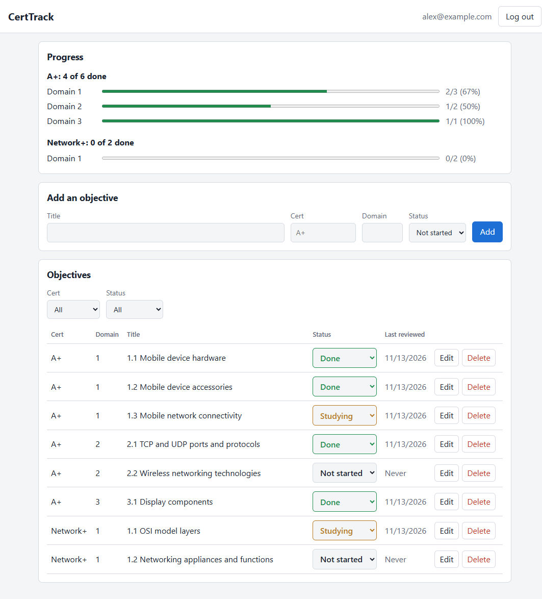

# CertTrack

[](https://github.com/alberto210495/CertTrack/actions/workflows/ci.yml)

A study tracker for CompTIA exam objectives. You add the objectives of an exam, mark them as you study, and see how much of each domain is done.

It comes in two forms that share the same model and logic: a web app with accounts, and a command-line app.



## What it does

- Register and log in. Each user sees only their own objectives.
- Add, edit and delete objectives, and move them between not started, studying and done.
- Filter by cert and status.
- See done and total per cert and domain.

## Built with

- C# on .NET 10
- ASP.NET Core API, EF Core and SQLite
- JWT login with hashed passwords
- Validation on every request body
- One HTML page with plain JavaScript, no framework
- 90 xUnit tests, run by GitHub Actions on every push

## Install

You need the [.NET 10 SDK](https://dotnet.microsoft.com/download).

```
git clone https://github.com/alberto210495/CertTrack.git
cd CertTrack
dotnet build
```

## Run the web app

```
dotnet run --project src/CertTrack.Api
```

Open http://localhost:5149 and create an account. The data is saved in `src/CertTrack.Api/certtrack.db`, which is created on the first run.

## Run the command-line app

```
dotnet run --project src/CertTrack.Cli -- add "1.1 Mobile device hardware" --cert A+ --domain 1
dotnet run --project src/CertTrack.Cli -- done 1
dotnet run --project src/CertTrack.Cli -- stats
```

```
A+
  Domain 1:  50% (1/2)
  Domain 2:   0% (0/1)
Network+
  Domain 1: 100% (1/1)
```

| Command | What it does |
|---|---|
| `add "<title>" --cert <cert> --domain <number>` | Adds an objective |
| `list [--cert <cert>] [--status <status>]` | Lists objectives, optionally filtered |
| `study <id>` | Marks an objective as studying |
| `done <id>` | Marks an objective as done |
| `stats` | Shows percent done per domain |
| `help` | Shows the command list |

The command-line app keeps its own data in `objectives.json`, in the folder you run it from. It does not share data with the web app.

## Test

```
dotnet test
```

## Layout

```
src/CertTrack.Core/        the Objective model and the stats calculation
src/CertTrack.Cli/         the command-line app
src/CertTrack.Api/         the API, the database and the web page
tests/CertTrack.Tests/     tests for Core and the command-line app
tests/CertTrack.Api.Tests/ tests that run the real API in memory
```

## More

[docs/DOCUMENTATION.md](docs/DOCUMENTATION.md) explains the API endpoints, how login works, and how the code is organised.
