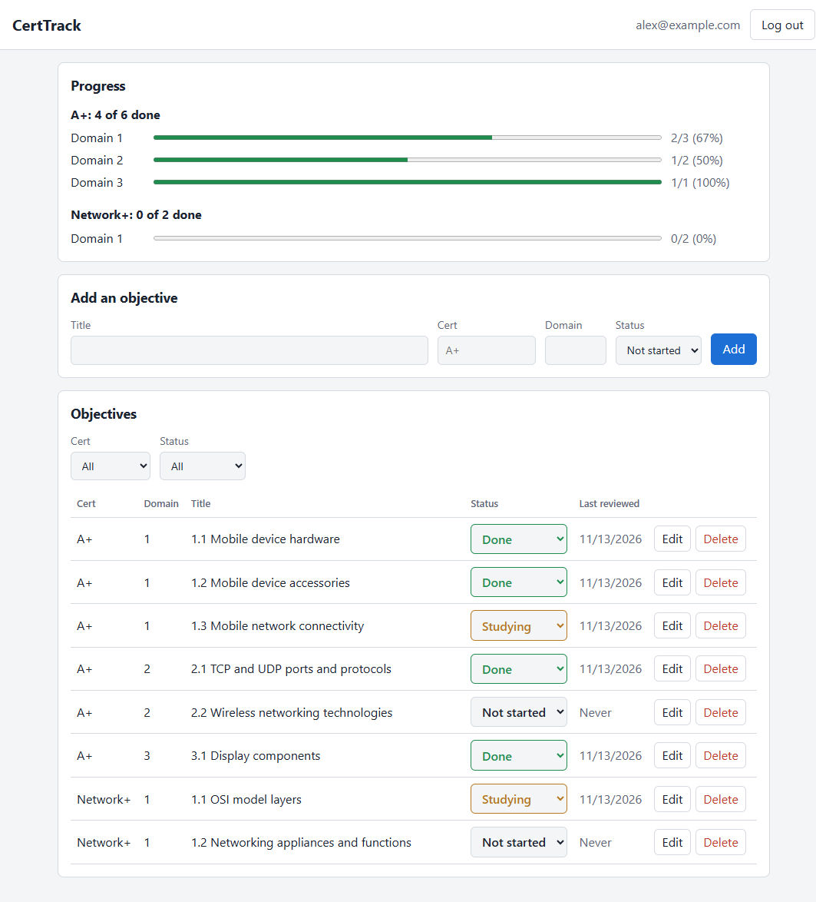

# CertTrack documentation

CertTrack is a study tracker for CompTIA exam objectives. You add the objectives of an exam, mark them as you study, and see how much of each domain is done.

It is written in C# on .NET 10 and has two apps that share one model:

- **The web app**: an ASP.NET Core API with a SQLite database, user accounts, and one HTML page.
- **The command-line app**: stores its data in one JSON file and needs no account.

The two apps do not share data.

## Contents

- [Running it](#running-it)
- [The command-line app](#the-command-line-app)
- [The web app](#the-web-app)
- [The API](#the-api)
- [Login and security](#login-and-security)
- [The database](#the-database)
- [Settings](#settings)
- [How the code is organised](#how-the-code-is-organised)
- [How each part works](#how-each-part-works)
- [C# features used](#c-features-used)
- [Tests](#tests)
- [Continuous integration](#continuous-integration)
- [Known limitations](#known-limitations)
- [Roadmap](#roadmap)

## Running it

You need the .NET 10 SDK. Run these from the repo root:

```
dotnet build
dotnet run --project src/CertTrack.Api
dotnet run --project src/CertTrack.Cli -- <command> [options]
```

- The second line starts the web app on http://localhost:5149.
- The third line runs the command-line app. Everything after `--` is passed to CertTrack.

## The command-line app

The examples below write `certtrack` for short; during development that means `dotnet run --project src/CertTrack.Cli --`.

| Command | What it does |
|---|---|
| `certtrack add "<title>" --cert <cert> --domain <number>` | Adds an objective |
| `certtrack list [--cert <cert>] [--status <status>]` | Lists objectives, optionally filtered |
| `certtrack study <id>` | Marks an objective as studying |
| `certtrack done <id>` | Marks an objective as done |
| `certtrack stats` | Shows percent done per domain |
| `certtrack help` | Shows the command list (also `--help`, `-h`, or no arguments) |

### add

```
> certtrack add "1.1 Mobile device hardware" --cert A+ --domain 1
Added #1: 1.1 Mobile device hardware
```

- The title must be the first argument after `add`. Put it in quotes if it contains spaces.
- `--domain` must be a whole number, 1 or higher.
- New objectives start as `NotStarted`.
- If the cert is already stored with different capitalisation, the stored spelling is reused. After one objective with `--cert A+`, a later `--cert a+` is saved as `A+`. The first spelling you type is the one that sticks.

### list

```
> certtrack list
  1  Done        A+         D1  1.1 Mobile device hardware
  2  Studying    A+         D1  1.2 Mobile device accessories
  3  NotStarted  Network+   D1  1.1 OSI model
```

The columns are id, status, cert, domain and title.

- `--cert A+` shows one cert only. The match ignores capitalisation.
- `--status` accepts `notstarted`, `studying` or `done`, in any capitalisation.
- Both filters can be combined.
- The status is coloured: green for done, yellow for studying, grey for not started.

### study and done

```
> certtrack study 2
Studying #2: 1.2 Mobile device accessories

> certtrack done 1
Done #1: 1.1 Mobile device hardware
```

Both set the status and record the current date and time as `LastReviewed`. `study` also works on an objective that is already done, which moves it back to studying.

### stats

```
> certtrack stats
A+
  Domain 1:  50% (1/2)
  Domain 2:   0% (0/1)
Network+
  Domain 1: 100% (1/1)
```

- Objectives are grouped by cert, then by domain.
- Only `Done` counts towards the percentage. `Studying` counts as not done.
- The percentage is green when the domain is complete, yellow when partly done and grey at zero.

### Errors and exit codes

Bad input prints a red `Error:` line and, where it helps, the usage of the command:

```
> certtrack add "Bad domain" --cert A+ --domain one
Error: The domain must be a positive number, not 'one'.
Usage: certtrack add "<title>" --cert <cert> --domain <number>
```

- Error messages are written to stderr, so they stay out of piped output.
- The exit code is `0` on success and `1` on any error.
- If `objectives.json` cannot be parsed, CertTrack reports it and leaves the file untouched.

### The data file

Objectives are stored in `objectives.json` in the folder you run the command from, which is normally the repo root. The file is listed in `.gitignore` because it is personal data.

```json
[
  {
    "Id": 1,
    "Cert": "A+",
    "Domain": 1,
    "Title": "1.1 Mobile device hardware",
    "Status": "Done",
    "LastReviewed": "2026-11-13T22:50:38.2276721-06:00"
  }
]
```

| Field | Type | Notes |
|---|---|---|
| `Id` | number | Assigned by `add` |
| `Cert` | text | For example `A+` or `Network+` |
| `Domain` | number | The exam domain the objective belongs to |
| `Title` | text | The objective as you typed it |
| `Status` | text | `NotStarted`, `Studying` or `Done` |
| `LastReviewed` | date and time, or `null` | Set by `study` and `done`; `null` until then |

If the file does not exist, CertTrack treats it as an empty list and creates it on the first `add`.

## The web app

Start it with `dotnet run --project src/CertTrack.Api` and open http://localhost:5149.



- **Create an account** with an email and a password of at least 8 characters, or log in.
- **Progress** shows done and total for each cert and domain.
- **Add an objective** with a title, cert, domain (1 to 20) and status. The cert and domain stay filled in after adding, so several objectives of one domain are quick to enter.
- **Change a status** with the drop-down in the table. Moving to studying or done records the date as last reviewed.
- **Edit** loads an objective into the form. **Delete** asks first.
- **Filter** the table by cert and status.
- **Log out** forgets the login in this browser.

The page follows the light or dark theme of your system.

## The API

The page uses this API, and so can any other client. Bodies are JSON. Every endpoint except register and login needs the header `Authorization: Bearer <token>`.

| Method and path | What it does | Success |
|---|---|---|
| `POST /api/auth/register` | Creates an account and returns a token | 200 |
| `POST /api/auth/login` | Returns a token | 200 |
| `GET /api/objectives` | Lists your objectives. Optional `?cert=A%2B` and `?status=done` | 200 |
| `GET /api/objectives/{id}` | Returns one objective | 200 |
| `POST /api/objectives` | Adds an objective | 201 |
| `PUT /api/objectives/{id}` | Replaces an objective | 200 |
| `DELETE /api/objectives/{id}` | Deletes an objective | 204 |
| `GET /api/stats` | Done and total per cert and domain | 200 |

### Register and log in

```
POST /api/auth/register
{ "email": "alex@example.com", "password": "correct-horse-battery" }

200
{ "token": "eyJhbGciOi...", "email": "alex@example.com" }
```

| Field | Rules |
|---|---|
| `email` | Required, a valid email address, at most 254 characters |
| `password` | Required, 8 to 100 characters |

Login takes the same body. The email is trimmed and lower-cased, so `Alex@Example.com` and `alex@example.com` are the same account.

### Objectives

```
POST /api/objectives
{ "title": "1.1 Mobile device hardware", "cert": "A+", "domain": 1, "status": "Done" }

201
{
  "id": 1,
  "cert": "A+",
  "domain": 1,
  "title": "1.1 Mobile device hardware",
  "status": "Done",
  "lastReviewed": "2026-11-14T05:19:03.8142753Z"
}
```

| Field | Rules |
|---|---|
| `title` | Required, not blank, at most 200 characters |
| `cert` | Required, not blank, at most 30 characters |
| `domain` | A whole number from 1 to 20 |
| `status` | `NotStarted`, `Studying` or `Done`. Optional; `NotStarted` if left out. Numbers are rejected. |

- `PUT` takes the same body and replaces all four fields.
- `lastReviewed` is set by the server, in UTC, when the status changes to `Studying` or `Done`. A `PUT` that keeps the status leaves it alone.
- The cert spelling rule of the command-line app applies here too: `a+` is saved as `A+` if you already have an `A+` objective.
- The list is sorted by cert, then domain, then id.

### Stats

```
GET /api/stats

200
[ { "cert": "A+", "domain": 3, "done": 1, "total": 2, "percent": 50 } ]
```

### Errors

Errors use the standard "problem details" JSON format:

```
400
{
  "title": "One or more validation errors occurred.",
  "status": 400,
  "errors": {
    "Title": ["The Title field is required."],
    "Domain": ["The field Domain must be between 1 and 20."]
  }
}
```

| Status | When |
|---|---|
| 400 | The body or a query value is not valid |
| 401 | No token, a token that is expired or not valid, or a wrong email or password at login |
| 404 | The objective does not exist, or belongs to another user |
| 409 | Registering an email that already has an account |

## Login and security

- **Passwords are hashed.** ASP.NET Core's `PasswordHasher` stores a salted PBKDF2 hash. The password itself is never saved or logged.
- **Login returns a JWT.** The token holds the user id (`sub`) and email, is signed with HMAC-SHA256, and expires after 2 hours. The API checks the signature, issuer, audience and expiry on every request.
- **Each user sees only their own data.** Every query filters by the user id from the token. Asking for someone else's objective returns 404, the same as an id that does not exist, so the response does not reveal which ids are in use.
- **Login does not reveal which emails exist.** An unknown email and a wrong password get the same 401 and the same message.
- **The signing key is a secret and is not in the repo.** See [Settings](#settings).
- **The page cannot run injected scripts.** User text is written with `textContent`, never `innerHTML`. Every response also carries a `Content-Security-Policy` header that only allows scripts and styles from the site itself, plus `X-Content-Type-Options: nosniff`.
- **The page keeps the token in the browser's `localStorage`.** When the API answers 401, the page logs out and asks you to log in again.

## The database

The web app stores its data in a SQLite file, `src/CertTrack.Api/certtrack.db`. It is created on the first run and is listed in `.gitignore`.

| Table | Columns |
|---|---|
| `Users` | `Id`, `Email` (unique), `PasswordHash` |
| `Objectives` | `Id`, `UserId`, `Cert`, `Domain`, `Title`, `Status` (stored as text), `LastReviewed` |

Deleting a user row deletes their objectives too.

The tables are created by EF Core migrations in `src/CertTrack.Api/Migrations/`. The app applies any new migration when it starts. After changing a model class, add a migration:

```
dotnet tool restore
dotnet ef migrations add <Name> --project src/CertTrack.Api
```

`dotnet tool restore` installs the `dotnet-ef` tool listed in `dotnet-tools.json`. To start over with an empty database, stop the app and delete the `certtrack.db` files.

## Settings

Settings live in `src/CertTrack.Api/appsettings.json`. Any of them can be overridden with an environment variable, using `__` in place of `:`.

| Setting | Default | Meaning |
|---|---|---|
| `ConnectionStrings:Default` | `Data Source=certtrack.db` | Where the database file is |
| `Jwt:Issuer`, `Jwt:Audience` | `CertTrack` | Written into each token and checked on each request |
| `Jwt:LifetimeMinutes` | `120` | How long a login lasts |
| `Jwt:Key` | not set | The secret that signs tokens. At least 32 characters. |

`Jwt:Key` must never be written into `appsettings.json` or committed.

- **In development** (`dotnet run`), leaving it unset is fine. The app makes a random key for that run and logs a warning. Logins stop working when the app restarts, and you log in again.
- **Anywhere else**, the app refuses to start without it. Set it as an environment variable:

```
$env:Jwt__Key = "<at least 32 random characters>"
```

## How the code is organised

The repo holds one solution, `CertTrack.slnx`, with five projects.

| Project | What it is |
|---|---|
| `src/CertTrack.Core/` | The model and logic both apps share. No console, file or web code. |
| `src/CertTrack.Cli/` | The command-line app |
| `src/CertTrack.Api/` | The API, the database and the web page |
| `tests/CertTrack.Tests/` | Tests for Core and the command-line app |
| `tests/CertTrack.Api.Tests/` | Tests for the API |

### CertTrack.Core

| File | Responsibility |
|---|---|
| `Objective.cs` | The `Objective` class, the `Status` enum, and `MoveTo`, which changes the status and records the review date |
| `StatsCalculator.cs` | Works out done and total per cert and domain |
| `CertName.cs` | Picks the cert spelling that is already in use |

### CertTrack.Cli

| File | Responsibility |
|---|---|
| `Program.cs` | Entry point. Picks the command from `args[0]` and returns its exit code. Catches file and JSON errors. |
| `Commands.cs` | One method per command, the help text, input validation and option parsing |
| `ObjectiveStore.cs` | Loads and saves the list of objectives as JSON |
| `Ui.cs` | Coloured console output: success, error and coloured text |

```
args -> Program.cs -> Commands.cs -> ObjectiveStore.cs -> objectives.json
                          |
                          +-> Core (Objective, StatsCalculator, CertName)
                          +-> Ui.cs (colours and errors)
```

### CertTrack.Api

| File or folder | Responsibility |
|---|---|
| `Program.cs` | Sets up the database, login, error format, security headers and static files, then starts the app |
| `Controllers/AuthController.cs` | Register and login |
| `Controllers/ObjectivesController.cs` | List, get, add, update and delete objectives |
| `Controllers/StatsController.cs` | The stats endpoint |
| `Contracts/` | The shapes of request and response bodies, with the validation rules |
| `Models/User.cs` | A user account |
| `Models/UserObjective.cs` | An `Objective` from Core plus the id of the user who owns it |
| `Data/AppDbContext.cs` | The EF Core database context: the tables and their rules |
| `Auth/JwtSettings.cs` | Reads the token settings and the signing key |
| `Auth/TokenService.cs` | Creates a token for a user |
| `Auth/ClaimsPrincipalExtensions.cs` | Reads the user id out of the token of the current request |
| `Migrations/` | Generated by EF Core. Do not edit by hand. |
| `wwwroot/` | The web page: `index.html`, `app.js`, `styles.css`, `favicon.svg` |

```
browser (app.js) -> controller -> AppDbContext -> certtrack.db
                        |
                        +-> Contracts (validation)
                        +-> Core (Objective.MoveTo, StatsCalculator, CertName)
```

## How each part works

### Shared

**Changing status.** `Objective.MoveTo` sets the status and, for `Studying` and `Done`, the review date. The caller passes in the current time, which makes it easy to test. The command-line app passes local time; the API passes UTC.

**Calculating stats.** `StatsCalculator.ByDomain` groups objectives by cert and domain, sorts the groups, and returns one `DomainStats` per group holding the done count and the total. `DomainStats.Percent` is `100 * Done / Total`. It only calculates; printing and JSON are left to the apps.

### Command-line app

**Choosing the command.** `Program.cs` uses a `switch` on `args[0]`. Each command method returns an `int`, and `Program.cs` returns that as the process exit code.

**Reading options.** `GetOption` in `Commands.cs` looks for an option name such as `--cert` anywhere in the arguments and returns the argument after it. If there is nothing after it, or the next argument starts with `--`, it returns `null`. `IsMissingValue` uses that to tell "option not given" apart from "option given without a value".

**Assigning ids.** `add` uses 1 for the first objective, and the highest existing id plus 1 after that.

**Saving.** Every command that changes data follows the same three steps: load the whole list, change it in memory, save the whole list. `ObjectiveStore` sets three serializer options:

| Option | Effect |
|---|---|
| `WriteIndented` | One field per line, so the file is readable |
| `JsonStringEnumConverter` | Writes `"Status": "Done"` instead of `"Status": 2` |
| `UnsafeRelaxedJsonEscaping` | Writes `A+` instead of `A+`. The "unsafe" refers to embedding JSON in HTML, which this file never is. |

**Handling a broken file.** `Program.cs` wraps the commands in a `try`. A `JsonException` (invalid JSON, or an objective missing `Cert` or `Title`) and file access errors are turned into a one-line error instead of a stack trace.

### Web app

**Validating input.** The rules are attributes on the request classes in `Contracts/`, such as `[Required]` and `[Range(1, 20)]`. Because the controllers are marked `[ApiController]`, a request that breaks a rule is answered with 400 before the controller method runs.

**Registering.** `AuthController` trims and lower-cases the email, returns 409 if it is taken, hashes the password, saves the user and returns a token.

**Checking a token.** `Program.cs` configures JWT bearer authentication with the signing key, issuer and audience. Controllers marked `[Authorize]` reject requests without a valid token with 401. `User.GetUserId()` then reads the user id from the token.

**Keeping users apart.** `ObjectivesController.Find` looks for an objective by id *and* user id in one query. The get, update and delete methods all go through it, so there is one place where the rule lives.

**Reusing the model.** `UserObjective` inherits from Core's `Objective` and adds `UserId`. The command-line app keeps using the plain `Objective`, so its JSON file has no owner field.

**The page.** `app.js` keeps the token in `localStorage` and sends it with every `fetch`. After each change it reloads the stats and the list from the API and rebuilds those parts of the page with DOM methods.

## C# features used

| Feature | Where | What it does |
|---|---|---|
| Top-level statements | both `Program.cs` files | The file is the `Main` method; no class or method wrapper is needed |
| `required` properties | `Objective.cs`, `User.cs` | The compiler rejects `new Objective { ... }` unless `Cert` and `Title` are set |
| Nullable value type `DateTime?` | `Objective.cs` | `null` means "never reviewed" |
| Primary constructor | `ObjectiveStore.cs`, the controllers | Declares the constructor parameters on the class line. In the controllers, ASP.NET Core fills them in (dependency injection). |
| Collection expression `[]` | `ObjectiveStore.cs` | Shorthand for an empty list |
| Null-coalescing `??` | `CertName.cs`, `ObjectiveStore.cs` | Uses the right-hand value when the left is `null` |
| `record` | `StatsCalculator.cs`, `Contracts/` | A small immutable data type declared in one line |
| LINQ (`Where`, `GroupBy`, `OrderBy`, `Max`) | `Commands.cs`, `StatsCalculator.cs`, the controllers | Filtering, grouping and sorting. In the controllers EF Core turns it into SQL. |
| Switch expression | `Commands.cs` | `StatusColor` maps each status to a colour |
| Exception filter `when` | Cli `Program.cs` | One `catch` handles two exception types |
| Inheritance | `UserObjective.cs` | Adds `UserId` to the shared `Objective` |
| Attributes | the controllers, `Contracts/` | `[Authorize]`, `[HttpPost]`, `[Required]` attach rules to classes, methods and properties |
| `async` and `await` | the controllers | Database calls do not block a thread while they wait |
| Extension method | `ClaimsPrincipalExtensions.cs` | Adds `GetUserId()` to the built-in `ClaimsPrincipal` type |

## Tests

The tests use xUnit. Run all 90 from the repo root:

```
dotnet test
```

### tests/CertTrack.Tests (44 tests)

| File | What it checks |
|---|---|
| `ObjectiveStoreTests.cs` | A missing file loads as an empty list, saved objectives load back unchanged, saving replaces the old content, the JSON is written in readable form, and a broken file throws |
| `StatsCalculatorTests.cs` | Done and total counts per domain, studying not counting as done, certs kept separate, sort order, and the percentage |
| `CommandsTests.cs` | `add` saving objectives with the next id and reusing cert spelling, `study` and `done` changing status, and bad input failing without changing the data |
| `ObjectiveTests.cs` | `MoveTo` setting the status and the review date |
| `CertNameTests.cs` | Reusing the cert spelling that is already in use |

Each test that touches storage creates its own temporary file and deletes it afterwards, so tests never read or change a real `objectives.json`.

### tests/CertTrack.Api.Tests (46 tests)

| File | What it checks |
|---|---|
| `AuthTests.cs` | Register and login, the password being stored as a hash, duplicate emails, bad input, and that requests with no token, a made-up token or a token signed by another server get 401 |
| `ObjectivesTests.cs` | Add, list, filter, update and delete; every validation rule; unknown ids; that one user cannot see, change or delete another user's objective; and stats |
| `FrontEndTests.cs` | The page, script and stylesheet are served, and responses carry the security headers |

These tests start the real API in memory with `WebApplicationFactory` and send it real HTTP requests. Each test gets its own empty in-memory SQLite database (`ApiFactory.cs`), so tests cannot affect each other and never touch `certtrack.db`.

## Continuous integration

`.github/workflows/ci.yml` runs on every push and pull request. It restores, builds in Release mode and runs all the tests on Ubuntu.

## Known limitations

Command-line app:

- There is no command to delete or edit an objective. To fix a mistake, edit `objectives.json` by hand.
- The data file depends on the folder you run from. Running from a different folder starts a new, empty list.
- Options that CertTrack does not know, such as `list --foo`, are ignored without a warning.
- The tests do not check what the commands print, only what they save and the exit code they return.

Web app:

- It does not force HTTPS. On a real server it must run behind HTTPS, or passwords and tokens travel in clear text.
- A token cannot be cancelled. It works until it expires, and logging out only removes it from the browser.
- A token in `localStorage` can be read by any script that runs on the page. The Content-Security-Policy and the use of `textContent` are what keep such scripts out.
- There is no limit on login attempts, no password reset, no email confirmation and no way to delete an account.
- If two requests register the same email at the same instant, the second gets a 500 error instead of 409. The unique index still prevents a duplicate account.
- The list is not paged. Every objective of the user is returned at once.
- The web page has no automated tests. The API tests cover the server; the page was checked by hand in a browser.

Both:

- Domain numbers are not checked against the real exam.
- The two apps do not share data, and there is no import from `objectives.json` into the web app.

## Roadmap

Ideas, not built yet:

1. Import a list of exam objectives, so they do not have to be typed one by one.
2. Let the command-line app use the API, so both apps share data.
3. Limit login attempts.
